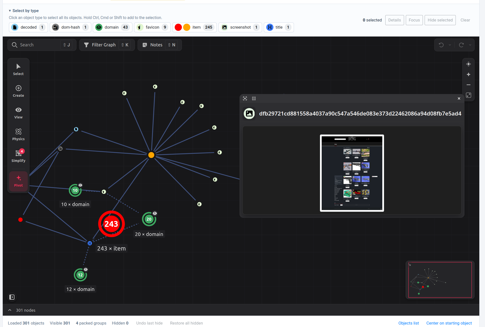

MISP-LEA project started the first June 2023. It consists in an law enforcement agency information sharing community. It's powered by [MISP](https://www.misp-project.org/)[^1] and [AIL project](https://www.ail-project.org/)[^2], two leading open source projects led by [CIRCL](https://www.circl.lu/).

# Background

MISP, the leading open source project for threat intelligence and information sharing, is used by different actors in the cyber security field including CERTs/CSIRTs, SOCs and law enforcement agencies. MISP is used in different use-cases ranging from investigation, remediation, reporting and cross-border collaboration. Within this project a MISP instance is set up dedicated for law enforcement agencies. The instance is fed with threat intelligence data from CIRCL and Shadowserver. The intelligence provided includes threat intelligence from CSIRT/CERTs networks, OSINT networks, non-governmental organisations and other LEA. Training for law enforcement agencies is provided by CIRCL and Shadowserver.

# Who is behind?

CIRCL hosts the dedicated MISP instance for law enforcement agencies. The project will serve as ground for having an EU-based open source software stack for information sharing in law enforcement agencies. MISP-LEA provides an efficient open source tool along with the intelligence to support pre-investigation to enhance crime reporting. This project is carried out by [CIRCL](https://www.circl.lu/) and [SHADOWSERVER](https://www.shadowserver.org/). CIRCL is the coordinator.

# Sustainability

MISP-LEA’s original co-funding period under the European Union’s Internal Security Fund (ISF) ended on 31 May 2025. The project continues with long-term support from CIRCL, which hosts, operates, maintains, and develops the platform through its sustainability program for law enforcement information sharing.

MISP-LEA is now part of the [HOPLITE project](https://hoplite-project.eu/) and receives co-funding through it.

MISP-LEA helps law enforcement agencies establish information-sharing practices and connects them with other sharing communities. CIRCL promotes MISP-LEA within its existing communities, including ISACs, so they can share information with law enforcement agencies in real time.

[^1]: MISP is an open source threat intelligence and sharing platform. MISP is a complete platform and standard to collect, structure, model intelligence such as threat intelligene, cyberecurity intelligence, financial fraud, vulnerability information, digital forensic investigations... 
[^2]: AIL Project is an open source framework to collect, crawl, dig and analyse unstructured data from different source including Tor. The framework can be used to find information leaks, intelligence, insights and much more.
