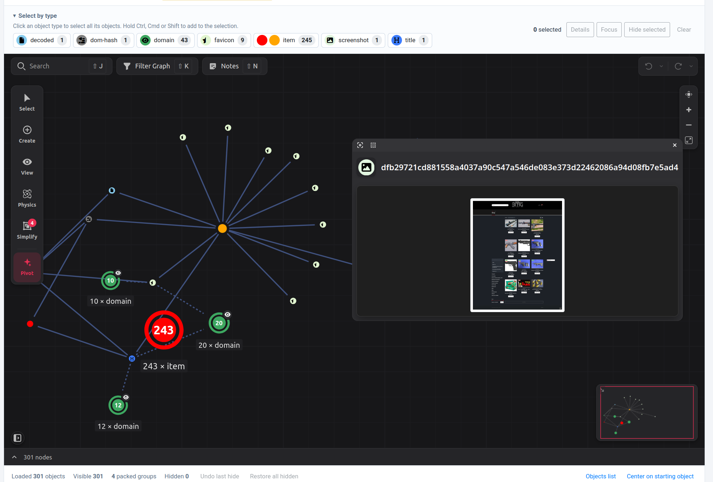

MISP-LEA combines hosted [MISP](https://www.misp-project.org/)[^1] and [AIL Project](https://www.ail-project.org/)[^2] instances for law enforcement agencies. Agencies can share threat intelligence through MISP and investigate leads by searching a large data lake through AIL. [CIRCL](https://www.circl.lu/) hosts both instances.

# Background

MISP, the leading open source project for threat intelligence and information sharing, is used by different actors in the cyber security field including CERTs/CSIRTs, SOCs and law enforcement agencies. MISP is used in different use-cases ranging from investigation, remediation, reporting and cross-border collaboration. Within this project a MISP instance is set up dedicated for law enforcement agencies. The instance is fed with threat intelligence data from CIRCL and Shadowserver. The intelligence provided includes threat intelligence from CSIRT/CERTs networks, OSINT networks, non-governmental organisations and other LEA. Training for law enforcement agencies is provided by CIRCL and Shadowserver.

## Infrastructure

- **MISP** provides a dedicated platform for sharing threat intelligence with trusted communities.
- **AIL Project** provides access to a large data lake spanning three years of Tor and I2P crawls, social network data, and other sources.

# Who is behind?

[CIRCL](https://www.circl.lu/) coordinates MISP-LEA and continues to host, operate, maintain, and develop the platform, including the dedicated MISP and AIL Project instances. CIRCL works with [The Shadowserver Foundation](https://www.shadowserver.org/) to provide an EU-based open source platform for threat intelligence sharing, investigations, and crime reporting.

MISP-LEA’s original co-funding period under the European Union’s Internal Security Fund (ISF) ended on 31 May 2025. The platform continues through CIRCL’s long-term sustainability program for law enforcement information sharing, supported by national funding and complementary co-funding through the [HOPLITE project](https://hoplite-project.eu/).

# FAQ

## I already operate my own MISP instance; why should I connect to MISP ?

MISP-LEA is connected to multiple sharing communities, allowing you to discover which community might have more information on the data under investigation. Additionally, you can both pull and push data from/to your MISP instance.
    
## Due to legal constraints we can only operated MISP-LEA in environments with no Internet connection or called airgapped systems.

As part of MISP-LEA, technical advice and software on setting up MISP in air-gapped environments are shared during the MISP-LEA events. Feel free to join one of these events to ask your questions, or alternatively, you can open issues at https://github.com/MISP/misp-airgap/ to explain your use cases.

## My MISP-instance is not connected to the Internet or I don't have any MISP server.

No worries. You can connect to MISP-LEA, download the relevant data you are interested in either via the web interface or the API, and use it in other forensic tools.

## Who maintains MISP-LEA now that the original EU funding period has ended?
{: #do-you-plan-to-maintain-the-misp-lea-after-the-end-of-the-eu-funding }

CIRCL continues to maintain MISP-LEA. See [Who is behind MISP-LEA?](#who-is-behind) for current funding and hosting details. Through MISP-LEA, CIRCL connects law enforcement agencies with established information-sharing communities, including ISACs, so they can share information in real time.

[^1]: MISP is an open source threat intelligence and sharing platform. MISP is a complete platform and standard to collect, structure, model intelligence such as threat intelligene, cyberecurity intelligence, financial fraud, vulnerability information, digital forensic investigations... 
[^2]: AIL Project is an open source framework to collect, crawl, dig and analyse unstructured data from different source including Tor. The framework can be used to find information leaks, intelligence, insights and much more.
